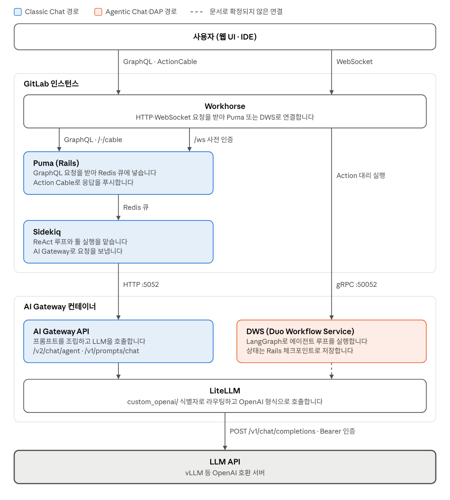
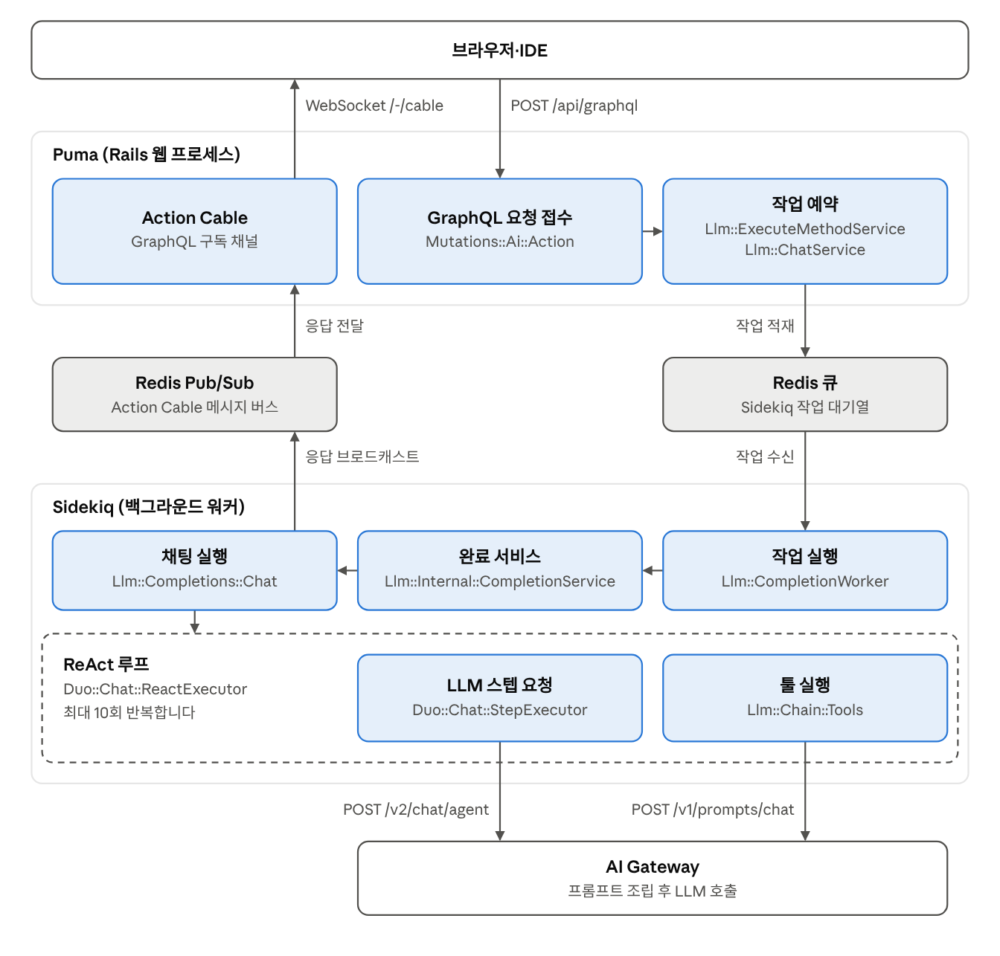
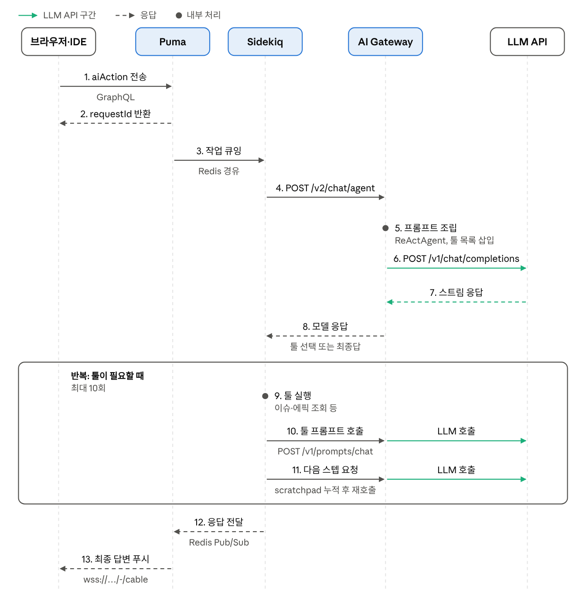
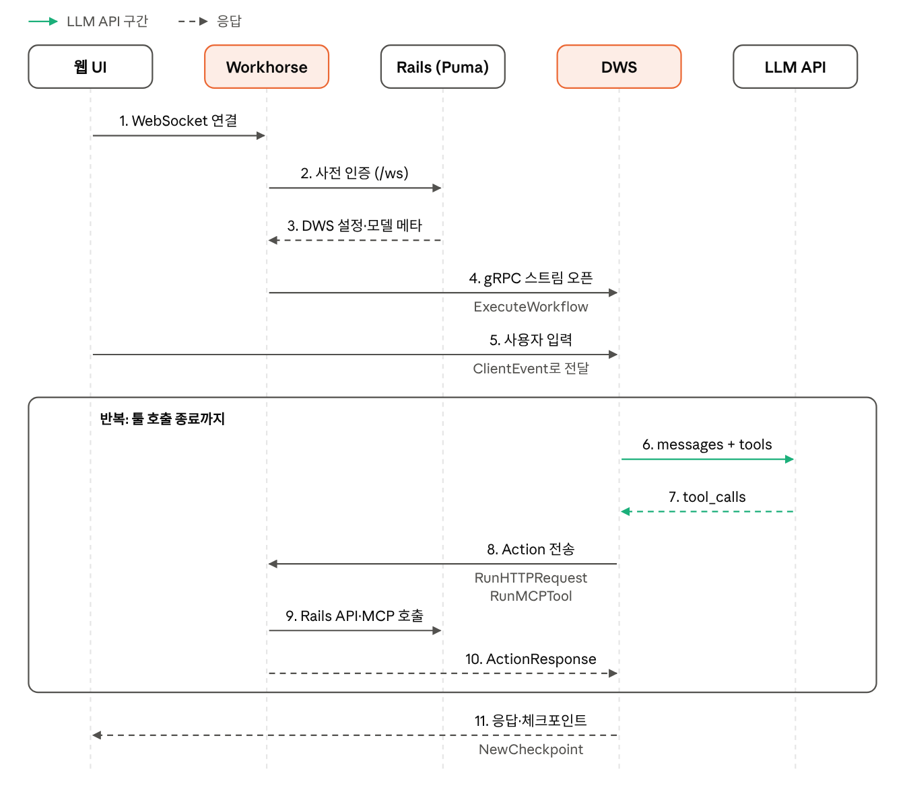
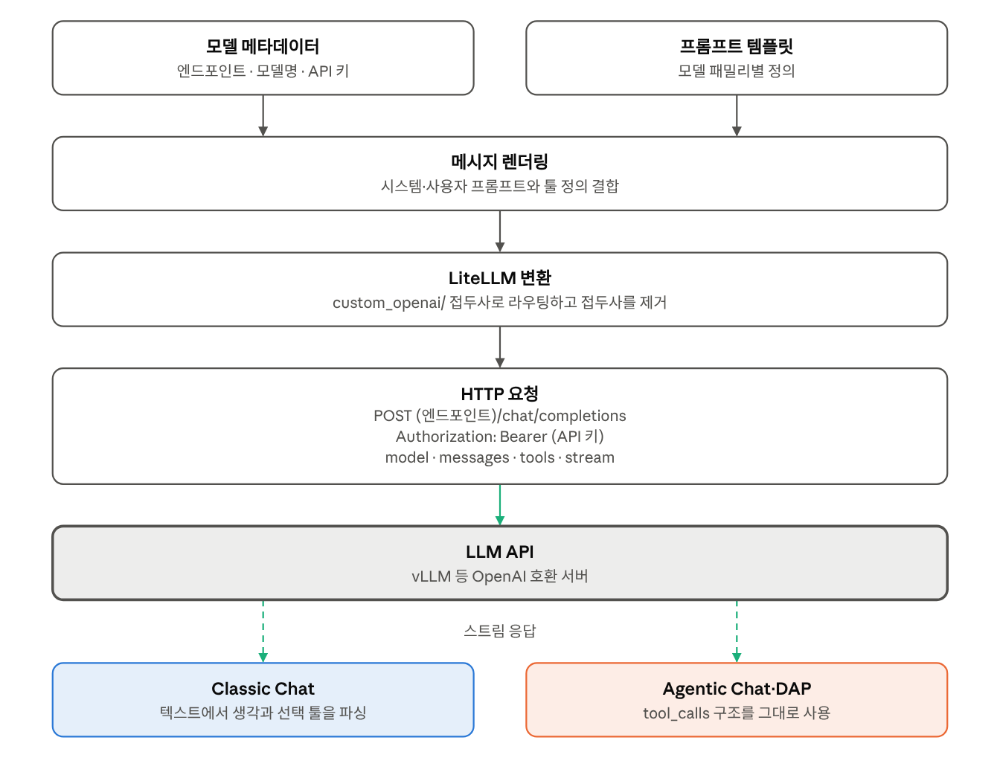
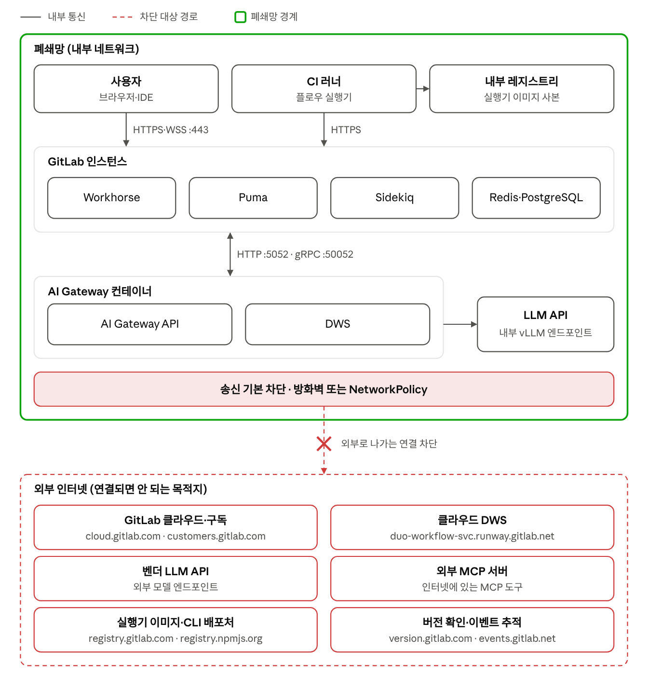

# GitLab Duo 셀프호스팅 요청 흐름: Chat·DAP와 AI Gateway·LLM API 통신

2026-11-05 · haesoo kim

## 핵심 정리

Classic Chat과 Agentic Chat·DAP는 내부 경로가 다르지만, LLM API로 나가는 마지막 호출은 모두 AI Gateway 컨테이너에서 보내는 OpenAI 호환 HTTP 요청입니다. 이 문서는 GitLab 19.5\~19.6 문서를 기준으로 정리했습니다.

- **Classic Chat:** Puma가 GraphQL 요청을 받아 Sidekiq으로 넘기고, Sidekiq 워커의 `ReactExecutor`가 최종 답이 나올 때까지 최대 10회 반복합니다.
- **Agentic Chat·DAP:** Workhorse가 Rails에서 사전 인증을 받은 뒤 DWS에 gRPC 스트림을 열고, 사용자 입력을 `ClientEvent`로 넘깁니다.
- **DWS와 Rails의 관계:** DWS는 Rails를 직접 호출하지 않고, Workhorse가 `RunHTTPRequest`를 받아 대신 실행합니다.
- **외부 통신:** 모델과 서비스 주소를 모두 내부로 지정하면 채팅 경로는 폐쇄망 안에서 끝납니다. 증명은 설정 확인, 송신 차단, 트래픽 증적으로 남깁니다.

## 전체 구조

채팅 경로는 두 갈래이고, LLM API로 나가는 마지막 구간에서 합쳐집니다.

**그림 1. 두 경로는 AI Gateway 컨테이너에서 LLM API 호출로 합쳐집니다**



Classic Chat은 HTTP `:5052`, Agentic Chat·DAP는 gRPC `:50052`로 AI Gateway 컨테이너에 들어갑니다. 두 경로 모두 Workhorse를 지나고, Classic만 Puma와 Sidekiq을 거쳐 AI Gateway로 갑니다.

## Rails·Sidekiq 구조

Classic Chat에서 Puma는 요청을 접수해 큐에 넣고, LLM 호출 루프는 Sidekiq 워커가 실행합니다.

**그림 2. Puma는 요청을 큐에 넣고, Sidekiq이 LLM 루프를 실행합니다**



그림의 클래스 이름은 `Gitlab::` 접두사를 생략했습니다.

| 구성 요소 | 역할 | 이 흐름에서 하는 일 |
| --- | --- | --- |
| Workhorse | 리버스 프록시 | 요청을 Puma로 보내고, Agentic 경로에서는 DWS 스트림을 엽니다. |
| Puma | Rails 웹 서버 | `aiAction`을 받아 작업을 큐에 넣고, Action Cable 연결을 유지합니다. |
| Redis | 큐·Pub/Sub | Sidekiq 작업과 Action Cable 메시지를 전달합니다. |
| Sidekiq | 백그라운드 워커 | `Llm::CompletionWorker`에서 ReAct 루프, 툴 실행, AI Gateway 호출을 맡습니다. |

- **네트워크:** Classic의 AI Gateway 호출은 Sidekiq에서 나갑니다. 방화벽과 NetworkPolicy는 Sidekiq에도 `:5052`를 허용해야 합니다.
- **장애 확인:** 응답이 늦게 보이면 Sidekiq 상태를 먼저 보고, `sidekiq_json.log`와 `llm.log`를 확인합니다.
- **Agentic Chat·DAP:** 웹 UI 시퀀스에는 Sidekiq이 없습니다. Puma는 사전 인증과 Workhorse가 대신 호출하는 API를 처리합니다.

## Classic Chat 흐름

Sidekiq 워커가 ReAct 루프를 돌리고, AI Gateway는 프롬프트 조립과 LLM 호출을 맡습니다.

**그림 3. Classic Chat은 Sidekiq이 루프를 돌리고 AI Gateway가 LLM을 호출합니다**



LLM이 최종 답을 내면 루프가 끝납니다. 아니면 Sidekiq 워커가 툴을 실행하고 결과를 쌓아 최대 10회까지 다시 호출합니다.

## Agentic Chat·DAP 흐름

루프의 주체는 DWS이고, DWS는 Rails를 직접 호출하지 않습니다.

**그림 4. Agentic Chat·DAP는 DWS가 루프를 돌리고 Workhorse가 Action을 대신 실행합니다**



DWS가 gRPC 스트림으로 Action을 보내면 Workhorse가 Rails API나 MCP 서버를 대신 호출합니다.

실행 위치에 따라 흐름이 조금 달라집니다.

- **웹 UI:** Workhorse 안에서 실행되며, 로컬 파일시스템이 필요 없는 플로우로 제한됩니다.
- **IDE:** `gitlab-lsp` 실행기가 사용자 환경에서 명령 실행과 파일 편집을 맡습니다.
- **CI 플로우:** Rails가 파이프라인을 만들고 러너의 실행기가 작업을 수행합니다.

## AI Gateway ↔ LLM API 통신

나가는 요청은 두 경로가 거의 같고, 돌아온 응답을 해석하는 방식이 다릅니다.

**그림 5. 나가는 요청은 같고, 응답을 해석하는 방식만 다릅니다**



- **모델 정보:** DAP에서는 Rails가 인스턴스 설정에서 모델 정보를 꺼내 `x-gitlab-agent-platform-model-metadata` 헤더로 넘기며, 여기에 API 키도 포함될 수 있습니다.
- **프롬프트:** Rails가 파라미터를 준비하고, AI Gateway가 프롬프트를 조립합니다.
- **호출 주소:** 엔드포인트는 `/v1`로 끝나야 하고, 추론 요청은 `<endpoint>/chat/completions`로 갑니다.
- **모델 식별자:** vLLM 같은 OpenAI 호환 서버는 `custom_openai/<모델명>` 형식을 씁니다.
- **인증:** LLM 호출에는 Bearer 토큰을 쓰고, AI Gateway 호출에는 인스턴스가 발급한 토큰을 쓰며 AI Gateway가 이를 검증합니다.
- **응답 해석:** Classic은 LLM 응답에서 생각과 선택된 툴을 파싱합니다. DWS 에이전트는 LLM의 함수 호출 기능으로 툴을 실행합니다.

## 경로별 차이

두 경로는 진입점부터 상태 저장까지 다르고, LLM API 호출 형식만 같습니다.

| 항목 | Classic Chat | Agentic Chat·DAP |
| --- | --- | --- |
| 진입점 | GraphQL `aiAction` | WebSocket `/api/v4/ai/duo_workflows/ws` |
| AI Gateway 연결 | HTTP `:5052` | gRPC `:50052` |
| 루프 주체 | Sidekiq 워커 | DWS (LangGraph) |
| 툴 실행 위치 | Sidekiq 워커 | Workhorse 또는 실행기 |
| 상태 저장 | 대화 스레드 | Rails 체크포인트 (PostgreSQL) |

## 구간별 점검 포인트

폐쇄망에서는 DAP 서비스 로컬 URL 설정부터 확인합니다. 비어 있으면 트래픽이 외부 서비스로 나가 연결이 실패합니다.

| 구간 | 확인할 내용 |
| --- | --- |
| 브라우저 ↔ GitLab | `wss://<instance>/-/cable`을 허용하고, 프록시에서 HTTP/2가 HTTP/1.1로 내려가지 않게 합니다. |
| Workhorse ↔ DWS | 서비스 URL은 TCP 주소입니다. `http://`나 `https://`를 붙이지 않습니다. |
| Workhorse ↔ DWS | 로컬 URL을 설정하지 않으면 트래픽이 `duo-workflow-svc.runway.gitlab.net`으로 나갑니다. |
| Workhorse ↔ DWS | 중간 L7 장비가 gRPC를 끊지 않는지 확인합니다. TLS를 쓰지 않으면 h2c로 통과해야 합니다. |
| AI Gateway ↔ LLM | 엔드포인트에 `/v1`이 빠지면 404가 납니다. |
| AI Gateway ↔ LLM | 19.3.x의 `verify_self_hosted_setup`은 `/v1/v1/models`를 호출해 정상 설정도 404로 표시했습니다. 사용 중인 버전에서 수정됐는지 확인합니다. |
| AI Gateway ↔ LLM | 컨텍스트가 크거나 질의가 복잡하면 AI Gateway 타임아웃을 늘립니다. |
| vLLM 호환성 | `tool_calls`를 받으려면 `--enable-auto-tool-choice`와 모델에 맞는 `--tool-call-parser`가 필요합니다. |
| vLLM 호환성 | DAP는 대화 중간에 system 메시지가 들어올 수 있어서, chat template이 이를 허용해야 합니다. |
| CI 러너 | GitLab 인스턴스 접속과 DAP 서비스로 가는 트래픽이 모두 허용됐는지 확인합니다. |
| 로그 | `AIGW_LOGGING__ENABLE_REQUEST_LOGGING`과 `AIGW_LOGGING__ENABLE_LITELLM_LOGGING`을 켜고 요청을 확인합니다. |

## 외부 통신이 없음을 보여주는 방법

그림만으로는 외부 통신이 없다는 증명이 되지 않습니다. 경계 그림에 설정 확인, 송신 차단, 트래픽 증적을 함께 남깁니다.

**그림 6. Duo 통신은 폐쇄망 안에서 끝나고, 외부 경로는 송신 차단으로 막습니다**



전제는 오프라인 라이선스, 내부 LLM 엔드포인트, 모든 기능의 자체 호스팅 모델 지정입니다. 기능 하나라도 GitLab 관리 모델을 쓰면 그 기능은 GitLab 호스팅 AI Gateway로 나갑니다.

### 막아야 할 외부 경로

| 외부 목적지 | 쓰이는 경우 | 폐쇄망 대응 |
| --- | --- | --- |
| `cloud.gitlab.com`, `customers.gitlab.com` | 클라우드 연결, 구독 동기화 | 오프라인 라이선스를 쓰고, `AIGW_CUSTOMER_PORTAL_URL`과 `DUO_WORKFLOW_AUTH__OIDC_CUSTOMER_PORTAL_URL`을 GitLab 주소로 지정합니다. |
| `duo-workflow-svc.runway.gitlab.net` | DAP 로컬 URL을 설정하지 않은 경우 | 로컬 URL을 내부 `:50052` 주소로 지정합니다. |
| 벤더 LLM API | GitLab 관리 모델이나 외부 엔드포인트를 지정한 경우 | 모든 기능에 내부 자체 호스팅 모델을 지정합니다. |
| 외부 MCP 서버 | Workhorse가 인터넷의 MCP 도구를 호출하는 경우 | 내부 MCP 서버만 등록합니다. |
| `registry.gitlab.com`, `registry.npmjs.org` | 러너가 실행기 이미지와 Duo CLI를 받는 경우 | 내부 레지스트리를 쓰고, `duo-cli`가 포함된 실행기 `v0.0.11` 이상을 지정합니다. |
| `version.gitlab.com`, `events.gitlab.net` | 버전 확인, 이벤트 추적 | 설정을 끄고 방화벽에서도 막습니다. 17.10\~19.5에서는 설정을 꺼도 버전 확인이 멈추지 않습니다. |

### 증명 절차

| 단계 | 확인할 내용 | 남길 증적 |
| --- | --- | --- |
| 1. 설정 | 모델 설정 화면에서 모든 기능이 자체 호스팅 모델인지 확인합니다. | 설정 화면 캡처 |
| 1. 설정 | `Ai::Setting.instance`의 `ai_gateway_url`과 `duo_agent_platform_service_url`이 내부 주소인지 확인합니다. | Rails 콘솔 출력 |
| 2. 차단 | 방화벽이나 NetworkPolicy로 송신을 기본 거부하고 내부 대역만 허용합니다. | 정책 파일 |
| 2. 차단 | Sidekiq, AI Gateway, 러너에서 `curl -m 5 https://cloud.gitlab.com`이 실패하는지 확인합니다. | 실패 로그 |
| 3. 증적 | 채팅과 플로우를 실행하는 동안 패킷을 캡처해 사설 대역 밖 목적지가 없는지 확인합니다. | `pcap` 파일 |
| 3. 증적 | 같은 시간대의 방화벽 거부 로그와 DNS 질의 로그를 확인합니다. | 로그 추출본 |

```bash
# 채팅을 보내는 동안 Sidekiq, AI Gateway, 러너가 실행되는 노드에서 실행합니다.
tcpdump -ni any -w duo-egress.pcap \
  'ip and not dst net 10.0.0.0/8 and not dst net 172.16.0.0/12 and not dst net 192.168.0.0/16 and not dst net 127.0.0.0/8 and not dst net 169.254.0.0/16 and not dst net 224.0.0.0/4'
```

캡처 결과가 비어 있으면 IPv4 기준으로 사설 대역 밖 송신이 없다는 뜻입니다. 내부망이 공인 대역을 쓰면 필터에 추가하고, IPv6을 쓰면 따로 확인합니다.

거부 로그에는 채팅과 무관한 시도가 남을 수 있습니다. 채팅 전에 기준선을 캡처해 두고, 채팅 중 늘어난 목적지만 비교합니다.

## 문서로 확정되지 않은 부분

아래 항목은 운영 환경의 로그로 검증한 뒤 판단합니다.

- **DWS의 LLM 호출 경로:** DWS가 LiteLLM을 거친다는 그림은 공유 코드베이스와 `custom_openai/` 식별자를 근거로 추정한 내용입니다.
- **Classic의 모델 정보 전달:** 공개 문서에서는 테스트 payload의 `model_endpoint`, `model_api_key` 필드만 확인했습니다. 실제 `/v2/chat/agent` 요청 형식은 요청 로그로 확인합니다.
- **설계 문서와 실제 구현:** 핸드북 설계 문서에는 DWS가 Rails API를 직접 호출한다는 설명이 있습니다. 운영 흐름은 Workhorse 개발 문서의 대리 실행 방식을 기준으로 봤습니다.
- **Sidekiq에서 Action Cable까지:** real-time 문서는 Redis Pub/Sub 구조만 설명합니다. Sidekiq 워커가 응답을 브로드캐스트한다는 연결은 Chat 문서의 설명을 조합해 정리했습니다.
- **외부 목적지 목록:** 표는 공식 문서에 나온 경로만 모았고, 버전에 따라 달라질 수 있습니다. 판단 기준은 목록이 아니라 트래픽 캡처 결과입니다.

## 출처

- [AI-assisted features architecture](https://docs.gitlab.com/development/workhorse/ai_assisted_features_architecture/)
- [GitLab Duo Chat 개발 문서](https://docs.gitlab.com/development/ai_features/duo_chat)
- [GitLab Duo Workflow 설계 문서](https://handbook.gitlab.com/handbook/engineering/architecture/design-documents/duo_workflow/)
- [GitLab Duo Self-Hosted 구성과 인증](https://gitlab.eidf.ac.uk/help/administration/gitlab_duo_self_hosted/configuration_types.md)
- [오프라인 환경 배포](https://docs.gitlab.com/ee/administration/gitlab_duo_self_hosted/offline_deployment.html)
- [Self-Hosted 모델 구성](https://code.ornl.gov/help/administration/gitlab_duo_self_hosted/configure_duo_features.md)
- [Self-Managed Duo 설정: 네트워크](https://docs.gitlab.com/administration/gitlab_duo/setup/)
- [Self-Managed Duo 설정: 러너](https://docs.gitlab.com/administration/gitlab_duo/configure/gitlab_self_managed)
- [Configure flow execution](https://docs.gitlab.com/user/duo_agent_platform/flows/execution/)
- [Self-Hosted 트러블슈팅](https://docs.gitlab.com/administration/self_hosted_models/troubleshooting)
- [Support Engineer Playbook](https://docs.gitlab.com/administration/gitlab_duo_self_hosted/support_engineer_playbook)
- [Self-Hosted 로깅](https://docs.gitlab.com/review-mr-401/administration/gitlab_duo_self_hosted/logging)
- [Duo Self-Hosted 기능 개발 문서](https://docs.gitlab.com/development/ai_features/developing_ai_features_for_duo_self_hosted/)
- [MR 234255: 모델 메타데이터 저장](https://gitlab.com/gitlab-org/gitlab/-/merge_requests/234255)
- [MR 254301: `/v1` 중복 수정](https://gitlab.com/gitlab-org/gitlab/-/merge_requests/254301)
- [GitLab architecture overview](https://docs.gitlab.com/development/architecture)
- [Real-time view components](https://docs.gitlab.com/development/real_time/)
- [Offline quick start guide](https://docs.gitlab.com/ee/topics/offline/quick_start_guide/)
- [GitLab Duo Self-Hosted 개요](https://gilsay.physics.gla.ac.uk/gitlab/help/administration/gitlab_duo_self_hosted/_index.md)
